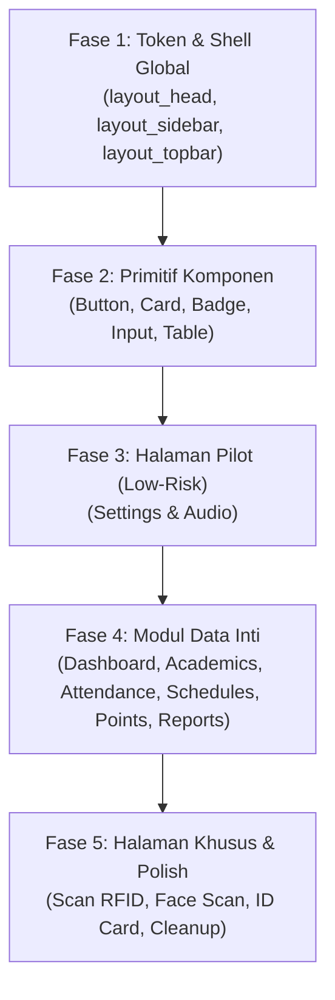

# 🎨 Master Plan Redesain UI SMK NIBA Super Apps (Gaya shadcn)

Dokumen ini adalah cetak biru (*blueprint*) dan panduan eksekusi untuk meredesain seluruh antarmuka aplikasi **SMK NIBA Super Apps (`bell-apps`)** dari tampilan bertema *Stisla* lama menjadi antarmuka modern, minimalis, dan elegan bergaya **shadcn/ui**, dengan mengadopsi prinsip semantik dan token dari repositori **[`codylindley/shadcn-html`](https://github.com/codylindley/shadcn-html)**.

---

## 🎯 Filosofi & Pendekatan Teknis (Opsi B: Migrasi Hibrida)

1. **Zero Downtime & Zero Functional Breakage:**
   - Logika JavaScript (event listener, filter table, sweetalert, API calls, Chart.js, camera face recognition) tidak boleh rusak.
   - Migrasi dilakukan secara bertahap per modul/halaman.
2. **Co-existence (Harmoni Tailwind + shadcn Tokens):**
   - Tetap memanfaatkan efisiensi Tailwind CSS yang sudah tertanam di codebase, dikombinasikan dengan variabel token CSS semantik (`--background`, `--foreground`, `--primary`, dll) dan kelas komponen spesifik ala `shadcn-html`.
3. **Web Standards & Clean Aesthetics:**
   - Palet warna netral kontras tinggi (Zinc / Slate + Neutral Dark), border tipis yang halus (`border-zinc-200/80` / `border-zinc-800`), font `Inter` yang rapi, dan radius modern (`rounded-lg` / `rounded-md`).
   - Menghapus elemen berat seperti banner ungu Stisla (`.navbar-bg`), shadow berlebih, dan navigasi yang ramai.

---

## 🎨 Model Token Semantik (shadcn Semantic Tokens)

Token desain berikut menjadi sumber kebenaran (*single source of truth*) yang diinjeksi ke `:root` dan `[data-theme="dark"]`:

| Token | Deskripsi / Peruntukan | Nilai Light Mode | Nilai Dark Mode |
|---|---|---|---|
| `--background` | Warna dasar kanvas/halaman | `#fafafa` (Zinc-50) | `#09090b` (Zinc-950) |
| `--foreground` | Teks utama | `#09090b` (Zinc-950) | `#fafafa` (Zinc-50) |
| `--card` | Background panel / kartu / tabel | `#ffffff` (White) | `#09090b` / `#18181b` (Zinc-900) |
| `--card-foreground` | Teks di dalam kartu | `#09090b` | `#fafafa` |
| `--primary` | Aksen tombol utama / brand | `#18181b` (Zinc-900) | `#fafafa` (Zinc-50) |
| `--primary-foreground` | Teks di atas tombol primary | `#fafafa` (White) | `#18181b` (Zinc-900) |
| `--secondary` | Tombol sekunder / badge | `#f4f4f5` (Zinc-100) | `#27272a` (Zinc-800) |
| `--secondary-foreground` | Teks tombol sekunder | `#18181b` | `#fafafa` |
| `--muted` | Background elemen pasif / input bg | `#f4f4f5` (Zinc-100) | `#27272a` (Zinc-800) |
| `--muted-foreground` | Teks bantuan / placeholder | `#71717a` (Zinc-500) | `#a1a1aa` (Zinc-400) |
| `--border` | Garis tepi elemen / pemisah | `#e4e4e7` (Zinc-200) | `#27272a` (Zinc-800) |
| `--ring` | Focus ring accessibility | `#18181b` | `#d4d4d8` |
| `--radius` | Border radius default | `0.5rem` (8px) | `0.5rem` |

---

## 🗺️ Roadmap & Checklist Eksekusi Bertahap

---

### [x] Fase 1: Fondasi Token & Master Shell (SELESAI ✅)
> **Tujuan:** Mengubah "bingkai luar" (Layout Master) seluruh halaman admin sehingga langsung terasa seperti dashboard shadcn modern.

- [x] **1.1. Injeksi Semantic Tokens di `views/admin/layout_head.html`:**
  - Tambahkan variabel CSS token `:root` dan `[data-theme="dark"]`.
  - Sesuaikan `tailwind.config` agar mengenali warna zinc/neutral shadcn.
  - Hapus background ungu tua Stisla (`.navbar-bg`).
- [x] **1.2. Redesain `views/admin/layout_sidebar.html`:**
  - Ubah style sidebar menjadi clean border kanan (`border-r border-zinc-200 dark:border-zinc-800`).
  - Item menu dengan hover `bg-zinc-100 dark:bg-zinc-800/60` dan active state `bg-zinc-900 text-white dark:bg-zinc-100 dark:text-zinc-900` atau pill neutral.
  - Perbarui logo header & status sekolah agar lebih minimalis dan proporsional.
- [x] **1.3. Redesain `views/admin/layout_topbar.html`:**
  - Ubah topbar menjadi sticky/flat tanpa background gradient ungu, terintegrasi mulus dengan background halaman.
  - Perbarui indikator koneksi bel, tombol switch dark mode, notifikasi, dan avatar profil pengguna.
- [x] **1.4. Redesain `views/admin/layout_footer.html`:**
  - Footer minimalis dan bersih.

---

### [x] Fase 2: Standarisasi Primitif Komponen (SELESAI ✅)
> **Tujuan:** Menyediakan komponen CSS reusable ala `shadcn-html` yang bisa langsung dipanggil di halaman mana pun.

- [x] **2.1. Tombol (`.btn`):**
  - Varian: `default` (hitam/putih), `secondary`, `outline`, `destructive`, `ghost`, `link`.
  - Ukuran: `sm`, `default`, `lg`, `icon`.
- [x] **2.2. Kartu (`.card-shadcn`):**
  - Struktur: `.card-shadcn`, `.card-header`, `.card-title`, `.card-description`, `.card-content`, `.card-footer`.
  - Border halus `border-zinc-200/80`, shadow tipis `shadow-xs`.
- [x] **2.3. Form Elements:**
  - Input, Textarea, Select dengan gaya ring focus shadcn (`.input-shadcn`).
  - Checkbox & Switch toggle modern.
- [x] **2.4. Badges & Status Pills (`.badge-shadcn`):**
  - Varian status: default, secondary, outline, destructive, success, warning.
- [x] **2.5. Table Standard (`.table-shadcn`):**
  - Clean table header (`bg-zinc-50 dark:bg-zinc-900`), zebra/hover state halus, padding proporsional.

---

### [x] Fase 3: Halaman Percontohan / Pilot Page (SELESAI ✅)
> **Tujuan:** Menguji dan memvalidasi implementasi pada halaman yang aman dan terisolasi sebelum ke data utama.

- [x] **3.1. Redesain `views/admin/settings.html` (Pengaturan Aplikasi):**
  - Tampilan card pengaturan sekolah, jam kerja, sistem backup/restore.
  - Form input, switch aktif/nonaktif, dan tombol simpan bergaya shadcn.
- [x] **3.2. Redesain `views/admin/audio.html` (Audio & Rekaman Bel):**
  - List file audio, form upload, audio player mini, tombol trigger bel manual.
  - Memastikan interaksi audio JavaScript tetap berfungsi normal.

---

### [x] Fase 4: Redesain Modul Utama (Data-Heavy) (SELESAI ✅)
> **Tujuan:** Memperbarui halaman operasional harian yang memiliki traffic dan data terbesar.

- [x] **4.1. `views/admin/dashboard.html` (Dashboard Admin):**
  - Metrik stat cards (Total Siswa, Kehadiran Hari Ini, Status Bel, Pelanggaran).
  - Quick action buttons, leaderboard, status bar IoT, modal pengumuman kilat & absensi manual.
- [x] **4.2. `views/admin/academics.html` (Data Master Akademik):**
  - Tab navigasi (Siswa, Staff/Guru, Kelas, Jurusan).
  - Search bar + dropdown filter kelas/jurusan.
  - Table data master dengan checkbox bulk action dan tombol action bar.
  - 6 Modal Form (Tambah/Edit Siswa, Staff, Kelas, Jurusan, Import CSV).
- [x] **4.3. `views/admin/attendance.html` (Presensi Harian):**
  - Filter tanggal, kelas, dan status kehadiran.
  - Rekap badge kehadiran (Hadir, Sakit, Izin, Alpha).
  - Tab log presensi harian & presensi sholat berjamaah, modal manual & modal jam presensi.
- [x] **4.4. `views/admin/schedules.html` (Jadwal Bel Otomatis):**
  - Manajemen slot waktu jadwal harian dan khusus.
  - Preview nada bel, modal tambah/edit jadwal.
- [x] **4.5. `views/admin/points.html` & `views/admin/reports.html`:**
  - Manajemen poin pelanggaran & prestasi kesiswaan, formula skor komposit, reset satuan & massal.
  - Laporan komprehensif kehadiran PDF/Preview & review tugas English Quest.
- [x] **4.6. `views/admin/student_detail.html` (Profil Lengkap Siswa):**
  - Detail riwayat presensi kalender interaktif, catatan poin karakter, ID card preview, dan data RFID/Face bio.

---

### [x] Fase 5: Halaman Khusus, Publik, & Pembersihan Akhir (SELESAI ✅)
> **Tujuan:** Menyempurnakan halaman sisi publik dan membuang style lama.

- [x] **5.1. Halaman Kiosk / Public:**
  - `views/index.html` (Landing Page Utama bergaya Clean Modern Minimalism ala BloomFi reference).
  - `views/login.html` (Halaman Login Admin Shadcn Auth Style).
  - `views/scan.html` & `views/scan_prayer.html` (Scan Kartu RFID / QR Kiosk).
  - `views/attendance_face.html` & `views/face_register.html` (Face Recognition & Pendaftaran Wajah).
- [x] **5.2. ID Card Print View:**
  - `views/idcard_single.html` (Cetak ID Card Digital standar PVC 54mm x 85mm).
- [x] **5.3. Pembersihan & Optimasi:**
  - Standardisasi semantic tokens (Zinc/Slate) dan penonaktifan navbar ungu Stisla.
  - Verifikasi Dark Mode di seluruh halaman (`data-theme="dark"`).
  - Lulus kompilasi Go (`go build`), verifikasi template (`go vet`), dan test suite (`go test ./tests`).

---

### [x] Fase 6: Modul Sarpras & Asset Management Terpadu (SELESAI ✅)
> **Tujuan:** Mengintegrasikan pengelolaan inventaris sarpras, sirkulasi peminjaman, tiket perawatan & QR code ke dalam arsitektur modern shadcn UI.

- [x] **6.1. Sidebar Link & Routing:**
  - Sidebar di `views/admin/layout_sidebar.html` terhubung ke `/admin/sarpras` dengan ikon `package`.
  - Routing di `internal/router/router.go` mengarah ke handler terpadu `handler.SarprasPage(db)`.
- [x] **6.2. Stat Metrics & 4 Tab Modular di `views/admin/sarpras.html`:**
  - Stat Cards: Total Aset, Estimasi Nilai (Rp), Kondisi Baik, Perlu Servis/Rusak, Sedang Dipinjam.
  - Tab 1: Katalog Aset & Inventaris (KIB, filter ruang, filter kondisi, cetak label QR, edit, delete).
  - Tab 2: Sirkulasi Peminjaman (peminjaman siswa/guru, persetujuan admin, konfirmasi pengembalian).
  - Tab 3: Tiket Perawatan & Kerusakan (lapor kerusakan, update status Open/In Progress/Resolved).
  - Tab 4: Master Ruang & Kategori KIB.
- [x] **6.3. QR Code Label Generator:**
  - Modal cetak stiker QR code mandiri berbasis kode inventaris dan nama aset (`/admin/sarpras/api/asset/:id/qr`).

---

## 📌 Aturan Pengerjaan bagi Asisten / Pengembang
1. **Selalu centang `[x]` pada roadmap** di dokumen ini setiap kali sebuah sub-tugas selesai diimplementasikan.
2. **Jangan menghapus fungsionalitas JavaScript yang ada**, pastikan selector ID/Class yang dipakai JS dipertahankan atau diperbarui secara cermat.
3. **Selalu uji responsivitas mobile & desktop** serta mode **Light & Dark** pada setiap halaman yang selesai diredesain.

